# Pull Print

[](https://github.com/Hikki-dev/pull_printing_app/actions/workflows/ci.yml)


[](https://pull-print-demo.vercel.app)

[](LICENSE)

Send a document to print. It waits safely on a server. It only prints when you walk up to a printer, sign in with your work account and press **Print**. Printers and every person's page limit are managed from one screen.

<p align="center"></p>

<p align="center"><sub>A short walk through on a phone. <b><a href="https://pull-print-demo.vercel.app">Try it yourself</a></b>. It runs on sample data, so nothing is really printed and no account is needed.</sub></p>

You do not need to know how any of it works. Every screen says in plain words what to do next.

## On this page

* [What you get](#what-you-get)
* [How everything fits together](#how-everything-fits-together): one document, from sending to paper
* [Try it first](#try-it-first): the live demo, no account needed
* [Use it with your own accounts](#use-it-with-your-own-accounts): Microsoft 365 or Google Workspace
* [The screens, step by step](#the-screens-step-by-step)
  * [On a phone: steps 1 to 5](#on-a-phone-steps-1-to-5)
  * [At the printer's own screen](#at-the-printers-own-screen)
  * [For administrators](#for-administrators)
  * [Signing in with a work account](#signing-in-with-a-work-account)
* [Run it yourself](#run-it-yourself) and [host it for free](#host-it-for-free)
* [Your privacy and safety](#your-privacy-and-safety)
* [The API in one table](#the-api-in-one-table)
* [Limits](#limits) and [roadmap](#roadmap)
* [Help and more reading](#help-and-more-reading)

## What you get

| | | |
|---|---|---|
| **A phone and printer screen** | Sign in, see only your own documents, tick what you want, press Print | [Screens](#the-screens-step-by-step) |
| **Page limits that cannot be skipped** | Checked on the server. Going over blocks Print and says by how many pages | [Choose what to print](#2-choose-what-to-print) |
| **Work-account sign-in** | Microsoft 365 or Google Workspace. Only your organisation gets in | [Work accounts](#signing-in-with-a-work-account) |
| **One place to manage everything** | Add printers, set pages a month for one person or everyone, see what is still to set up | [Administrators](#for-administrators) |
| **Printer screens fixed to one printer** | Open a printer's link on its own screen and it prints there | [Printer's own screen](#at-the-printers-own-screen) |
| **A free demo** | Every visitor gets private sample documents | [Try it first](#try-it-first) |

## How everything fits together

Send once, walk up, sign in, press Print. The server holds the document until then, and decides who may do what.

<p align="center"><a href="docs/images/how-it-fits.svg">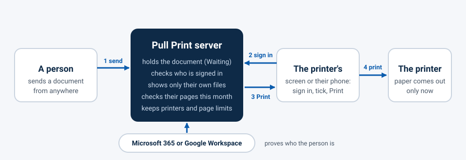</a></p>

The whole story, including who decides what, is in [How it works](docs/How%20it%20works.md).

## Try it first

**Live demo: <https://pull-print-demo.vercel.app>** (runs entirely in your browser on built-in sample data).

* Press **Sign in with Microsoft**. In the demo that signs you in to a private sandbox as "Alice Tan". No account is needed.
* You start with four sample documents and 38 of 50 pages left.
* Tick the documents you want and press **Print**. Tick too many and Print switches off and says by how many pages.
* Printing does not use a real printer. It marks the documents as printed and uses up pages.
* **Demo: sign in as administrator** shows every job and lets you manage printers and page limits, on a private copy of sample people.
* A banner on every screen says it is a demo, and **What is this?** explains it in plain words. It also has **Start over**.
* Other visitors never see your documents.

## Use it with your own accounts

Run the server with your Microsoft 365 or Google Workspace details and people sign in with the work account they already have. You add printers once, and set pages a month for one person or everyone, from one screen. Step by step, about ten minutes: **[Connecting your workspace](docs/09-connecting-your-workspace.md)**.

> Tested against a simulated Microsoft/Google sign-in only. It has not been run against a real tenant yet, so try it on a test tenant first ([issue #2](https://github.com/Hikki-dev/pull_printing_app/issues/2)).

## The screens, step by step

Every picture below was taken from the running app. Click one to see it full size. [Getting started](docs/Getting%20started.md) walks through the same screens with more detail, and [how the pictures are made](tools/screenshots/README.md) is explained if you want to refresh them.

### On a phone: steps 1 to 5

The whole phone journey, left to right. Click a picture to see it full size. Each step is explained under the pictures.

<table align="center">
<tr>
<td valign="top"><a href="docs/images/phone-1-sign-in.png">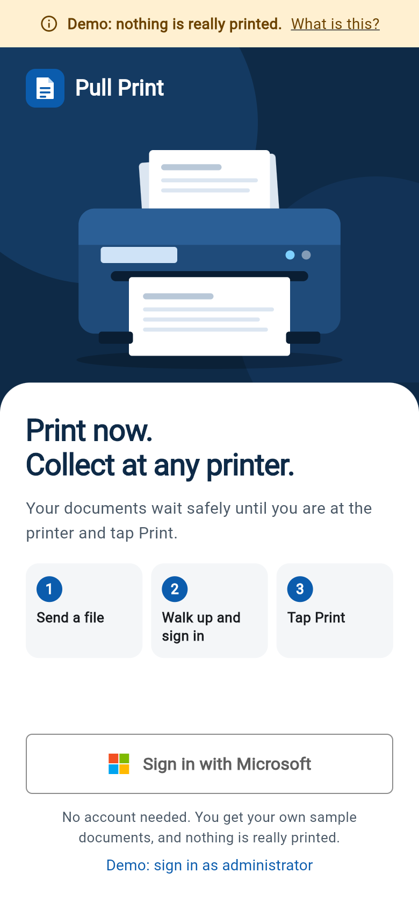</a></td>
<td valign="top"><a href="docs/images/phone-2-documents.png">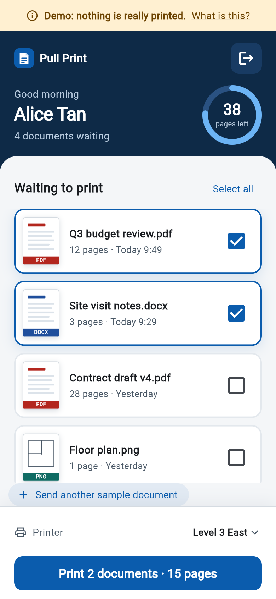</a></td>
<td valign="top"><a href="docs/images/phone-3-over-limit.png">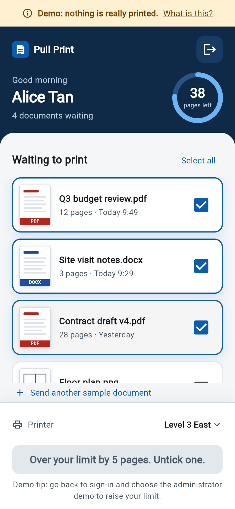</a></td>
<td valign="top"><a href="docs/images/phone-4-pick-printer.png">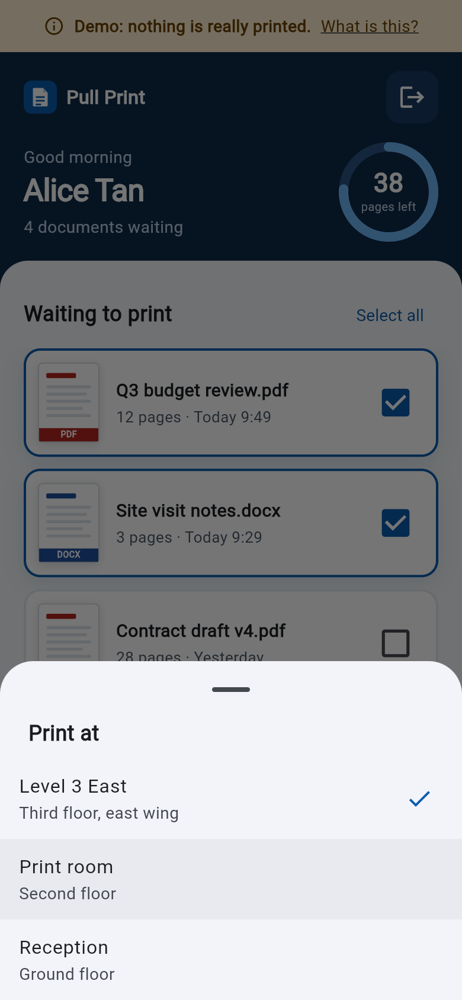</a></td>
</tr>
<tr>
<td align="center" valign="top"><b>1</b><br><sub>Sign in</sub></td>
<td align="center" valign="top"><b>2</b><br><sub>Choose what to print</sub></td>
<td align="center" valign="top"><b>3</b><br><sub>Over the limit</sub></td>
<td align="center" valign="top"><b>4</b><br><sub>Pick a printer</sub></td>
</tr>
</table>

<table align="center">
<tr>
<td valign="top"><a href="docs/images/phone-5-printed.png">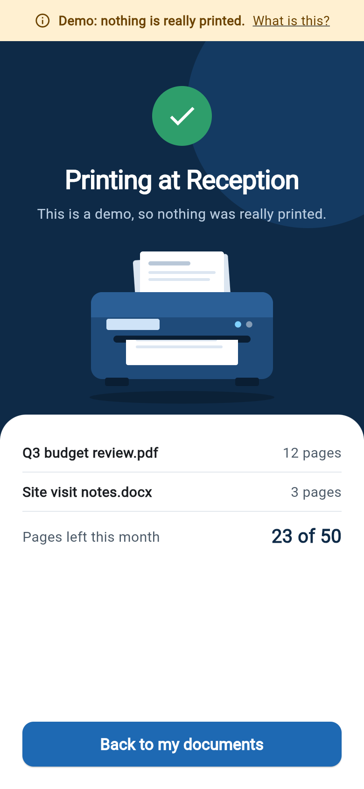</a></td>
</tr>
<tr>
<td align="center" valign="top"><b>5</b><br><sub>Printed</sub></td>
</tr>
</table>

**1. Sign in.** One button. There is no registration and no password field: the person signs in with their work account. In the demo the same button opens a private sandbox, and the banner at the top says so. **What is this?** in the banner explains the demo in plain words ([the dialog](#signing-in-with-a-work-account) is shown below).

**2. Choose what to print.** Only the person's own documents are listed, newest first. The newest ones are ticked for them, stopping before anything would go over their limit. The ring shows the pages left this month.

**3. Over the limit.** Tick a document that is too big, and Print switches off and says by how many pages, so the person knows to untick one.

**4. Pick a printer.** If more than one printer is set up, tap the printer name at the bottom to choose where to print.

**5. Print.** The confirmation names the printer, lists what printed, and shows the pages left. If the printer rejects some documents, they are named and stay on the list. Nothing is charged for a document that did not print.

### At the printer's own screen

Open a printer's **panel link** on the screen next to it, in full screen. It is fixed to that printer, so there is no question about where to print. It signs the person out after 60 seconds without a touch, and 20 seconds after printing, so the next person never sees their documents.

<p align="center"><a href="docs/images/panel-1-sign-in.png">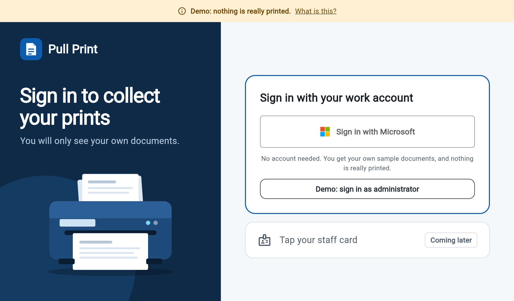</a></p>

<p align="center"><a href="docs/images/panel-2-documents.png">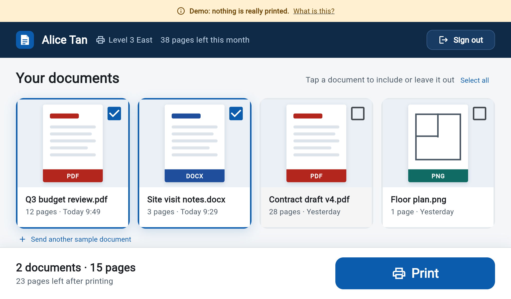</a></p>

<p align="center"><a href="docs/images/panel-3-printing.png">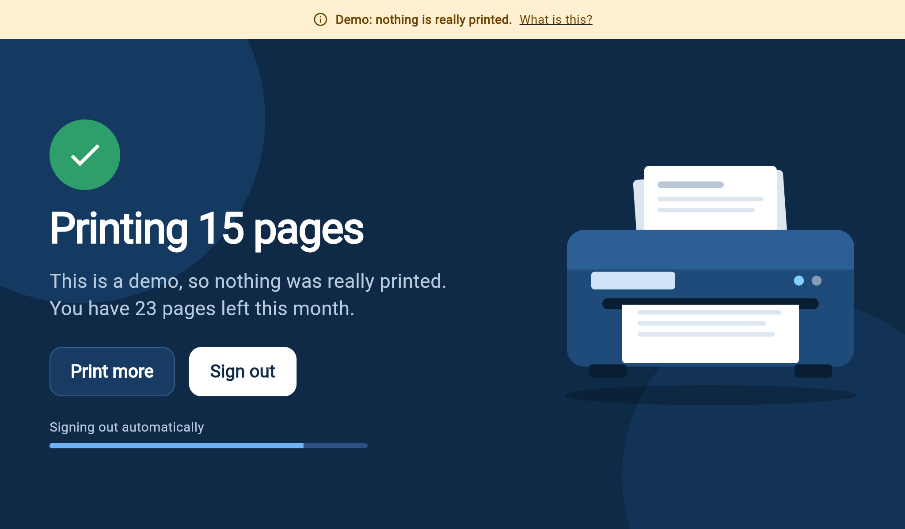</a></p>

Staff-card sign-in and a phone-code sign-in are drawn in the mockups but not built yet ([issue #6](https://github.com/Hikki-dev/pull_printing_app/issues/6)).

### For administrators

Everything an administrator needs is on one screen, in the order they need it.

<p align="center"><a href="docs/images/admin-1-overview.png">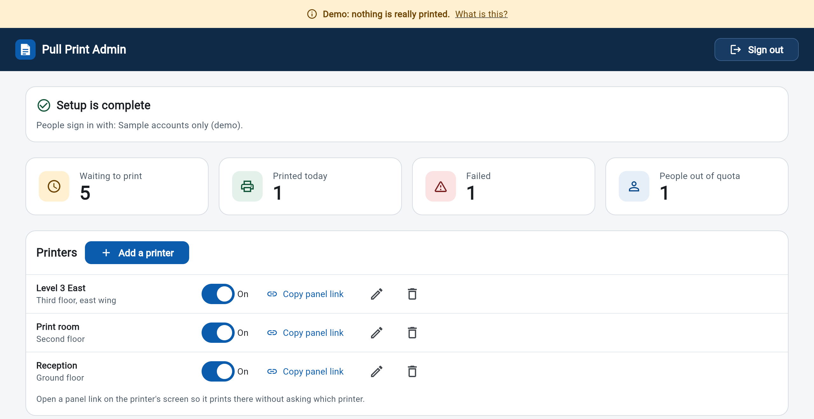</a></p>

**Setup.** The first card says **Setup is complete**, or **Finish setting up** with each thing still to do in plain words. For a Microsoft or Google set-up it also shows the exact sign-in address to register, with a **Copy** button.

<p align="center"><a href="docs/images/setup-1-finish.png">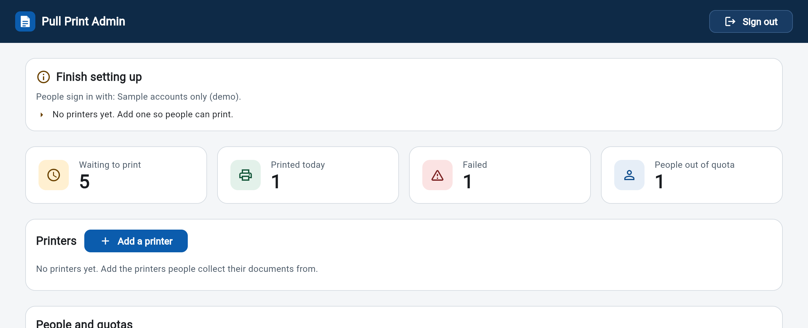</a></p>

<p align="center"><a href="docs/images/setup-2-register-address.png">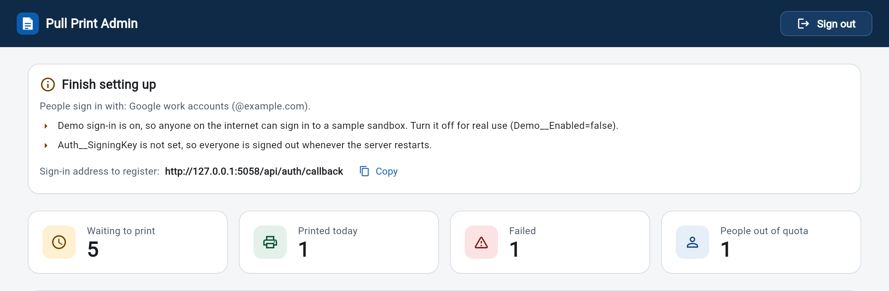</a></p>

**Printers.** Add, rename, switch off and remove printers. **Copy panel link** gives the address to open on that printer's own screen.

<p align="center"><a href="docs/images/admin-2-printers.png">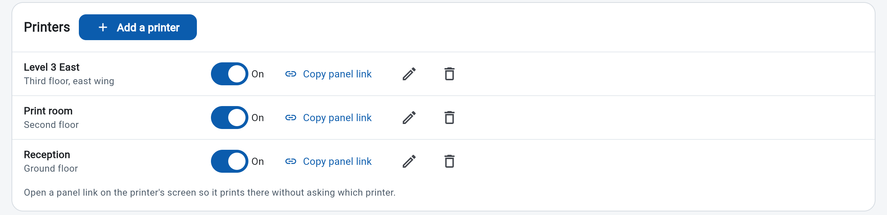</a></p>

<p align="center"><a href="docs/images/admin-5-add-printer.png">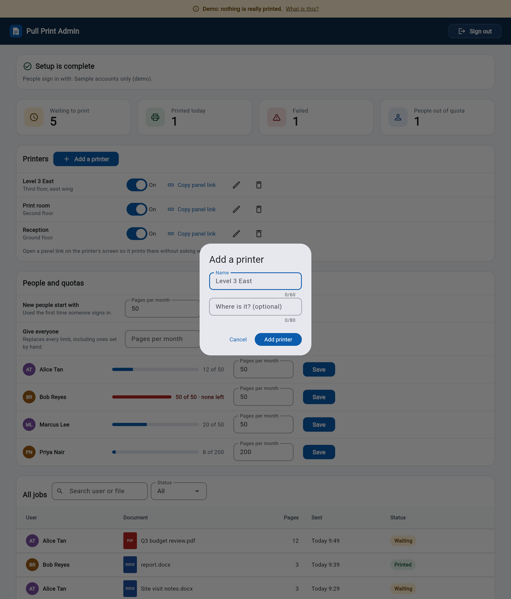</a></p>

**People and quotas.** **New people start with** sets the pages a month for anyone who signs in from now on. **Give everyone** sets one number for the whole organisation (it asks first, because it replaces every limit). Each person also has their own row. People appear here the first time they sign in. Pages start again on the 1st of every month.

<p align="center"><a href="docs/images/admin-3-people.png">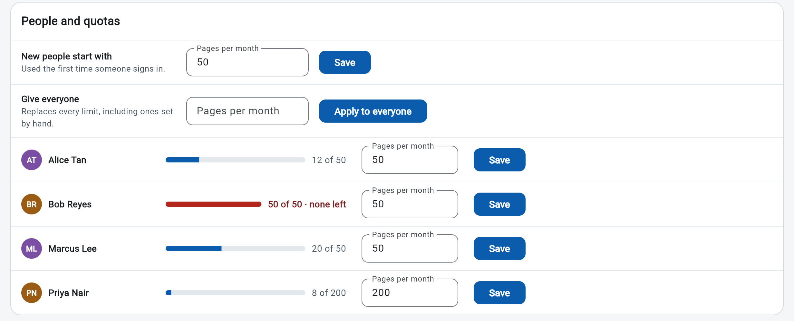</a></p>

<p align="center"><a href="docs/images/admin-6-apply-to-everyone.png">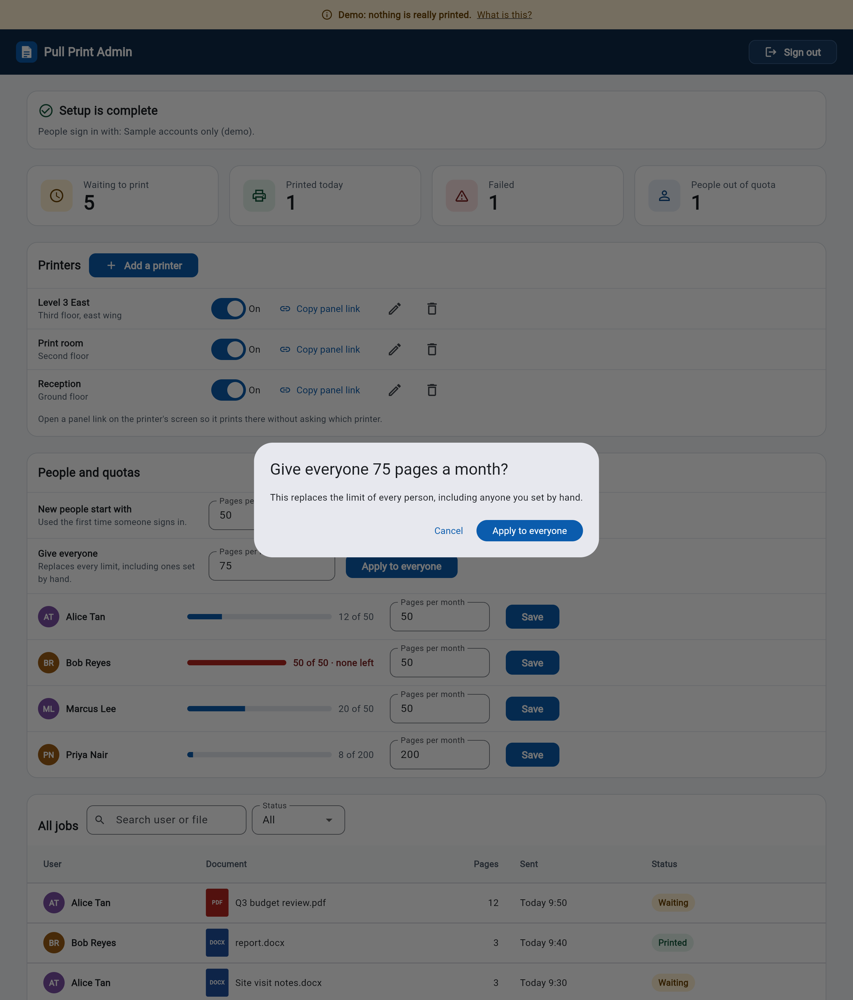</a></p>

**All jobs.** Every job with a search box and a status filter. A failed job says why.

<p align="center"><a href="docs/images/admin-4-jobs.png">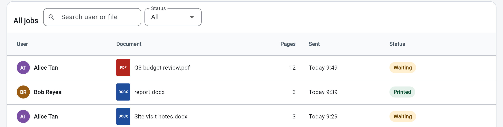</a></p>

### Signing in with a work account

When the server is set up for Microsoft 365 or Google Workspace, the sign-in button changes to match, and says who can use it.

<table align="center">
<tr>
<td valign="top"><a href="docs/images/phone-1b-about-demo.png">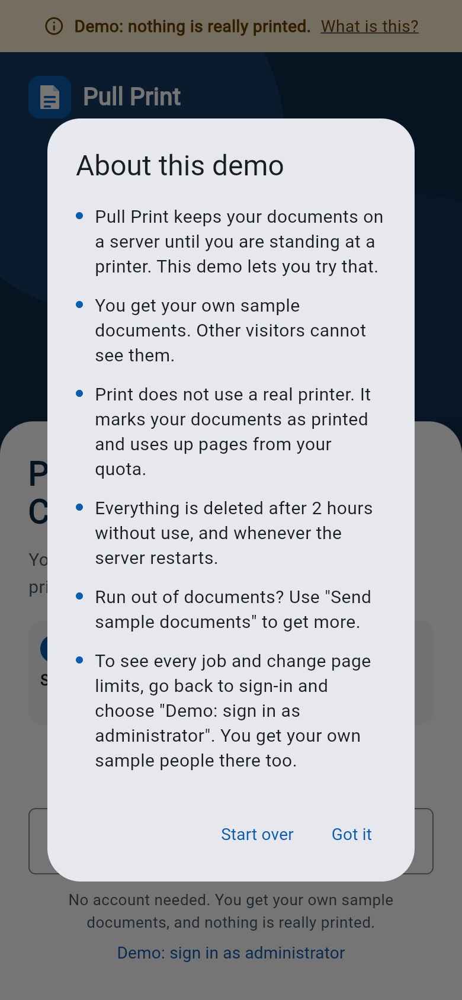</a></td>
<td valign="top"><a href="docs/images/workspace-google-phone.png">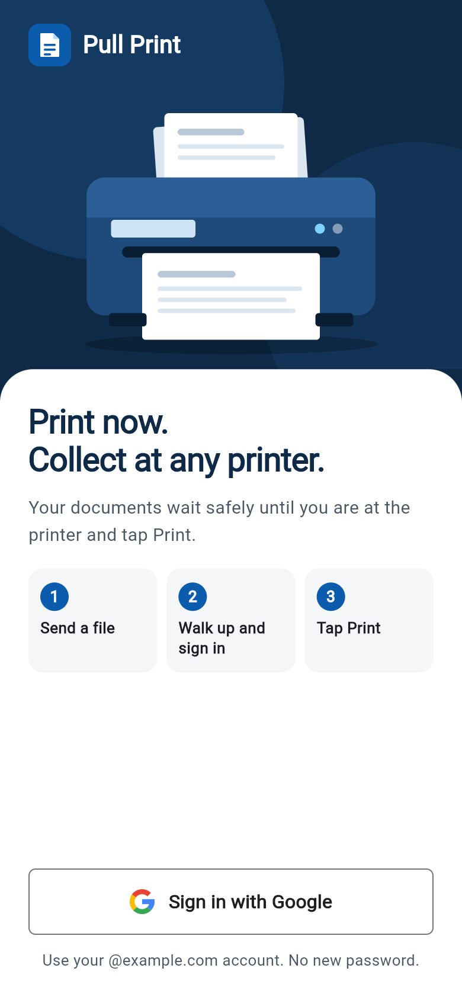</a></td>
<td valign="top"><a href="docs/images/workspace-microsoft-phone.png">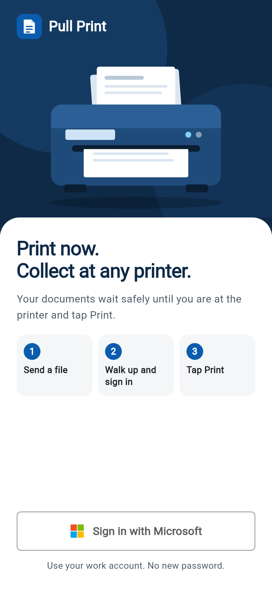</a></td>
<td valign="top"><a href="docs/images/workspace-with-demo.png">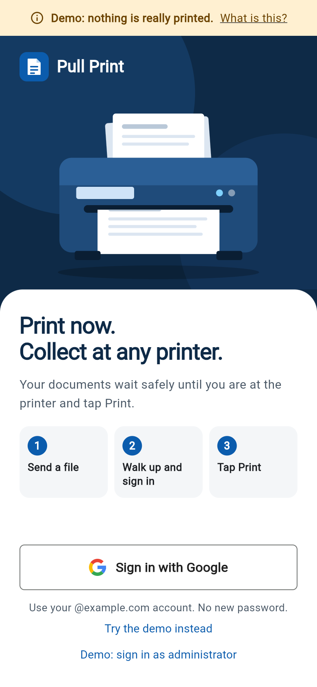</a></td>
</tr>
<tr>
<td align="center" valign="top"><b>1</b><br><sub>The About this demo dialog</sub></td>
<td align="center" valign="top"><b>2</b><br><sub>Google Workspace</sub></td>
<td align="center" valign="top"><b>3</b><br><sub>Microsoft 365</sub></td>
<td align="center" valign="top"><b>4</b><br><sub>With the demo still on</sub></td>
</tr>
</table>

Someone who is not allowed in sees the reason, and can try again:

<p align="center"><a href="docs/images/workspace-turned-away.png">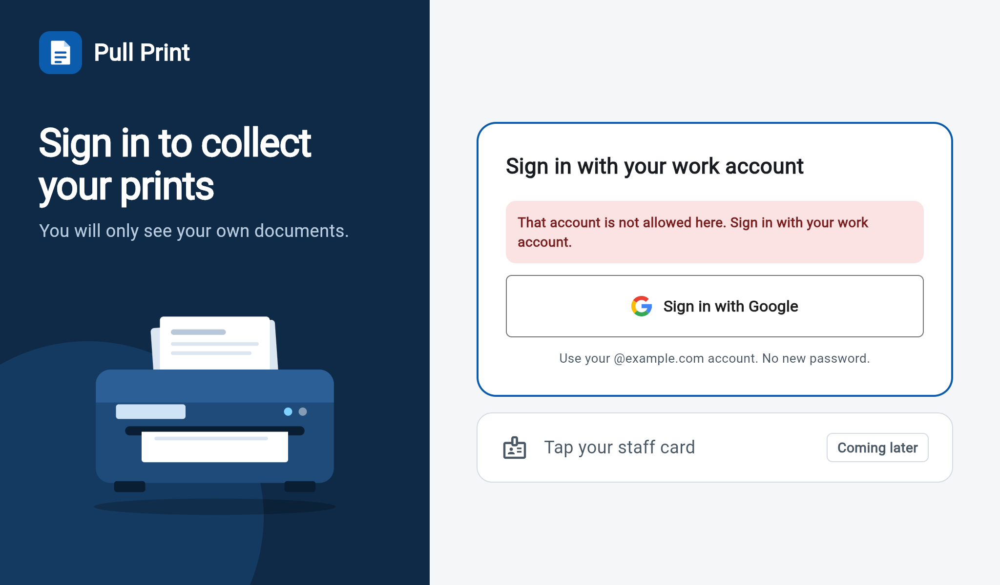</a></p>

What happens behind the button:

<p align="center"><a href="docs/images/sign-in-flow.svg">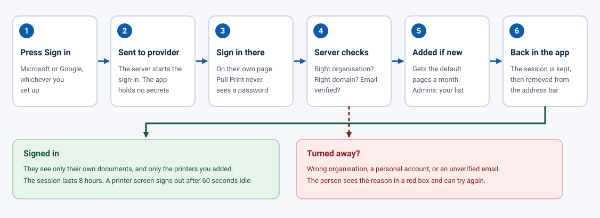</a></p>

## Run it yourself

You need the [Flutter SDK](https://docs.flutter.dev/get-started/install) and the [.NET 8 SDK](https://dotnet.microsoft.com/download).

```bash
git clone https://github.com/Hikki-dev/pull_printing_app.git
cd pull_printing_app

# Just the app, on built-in sample data. No server needed.
flutter pub get
flutter run -t frontend/lib/main.dart

# The whole thing: API plus app, the way the hosted demo runs.
flutter build web -t frontend/lib/main.dart --dart-define=USE_MOCK=false
mkdir -p backend/wwwroot && cp -r build/web/. backend/wwwroot/
ASPNETCORE_ENVIRONMENT=Development dotnet run --project backend   # then open the address it prints

# The app against an API running somewhere else (for example flutter run -d chrome)
flutter run -d chrome -t frontend/lib/main.dart \
  --dart-define=USE_MOCK=false --dart-define=API_BASE_URL=http://localhost:5000/api
```

Run the tests with `flutter test` (64) and `dotnet test backend.Tests` (112).

Screens narrower than 760 px use the phone layout, wider ones the printer-panel layout.

### Host it for free

Two ways, both described in [Hosting the demo](docs/06-demo-hosting.md):

* **Static, no server (what the live demo uses).** `vercel.json` and `scripts/vercel-build.sh` build the app on built-in sample data. Connect the repository to a Vercel project.
* **Full stack.** A `Dockerfile` builds the web app and the API into one image, and `render.yaml` deploys it on Render's free plan: create a free account, choose **New, Blueprint**, and pick this repository.

To use real accounts instead of the demo, follow [Connecting your workspace](docs/09-connecting-your-workspace.md).

### Repository layout

```
frontend/lib/        Flutter source: main.dart, screens, services, models, widgets, utils
backend/             ASP.NET Core API: controllers, services, models
backend.Tests/       API, store and sign-in tests (with a simulated Microsoft/Google)
test/                Flutter tests
tools/screenshots/   Takes every picture in these docs from the running app
scripts/             Build script for static hosting
docs/                Guides, design documents, pictures and mockups
Dockerfile           One image with the API and the web app
render.yaml          One-click free hosting on Render
.github/workflows/   CI: backend tests, Flutter tests, and the Docker image
CONTRIBUTING.md  SECURITY.md  CHANGELOG.md
```

The Flutter entry point is **`frontend/lib/main.dart`**, not `lib/main.dart`.

## Your privacy and safety

* **Every route except sign-in and `/healthz` needs a valid token.** Tokens are signed by the server and checked on every request. Admin routes need the Admin role.
* **People only reach their own data.** Printing ignores any document that is not yours and waiting. Administrators only see and change people in their own group.
* **Work accounts** sign in on Microsoft's or Google's own page. Pull Print never sees a password, only your organisation gets in, and the client secret stays on the server.
* **The demo** is limited to 20 sign-ins a minute per address, at most 300 sandboxes exist at once, and each is deleted after 2 hours without use. Switch it off for anything real (`Demo__Enabled=false`): its tokens stop working immediately.
* **Data is in memory** and is lost when the server restarts (see [Limits](#limits)).

To report a security problem, read [SECURITY.md](SECURITY.md).

## The API in one table

All routes except sign-in and health need `Authorization: Bearer <token>`.

| Method | Route | Who | What it does |
|---|---|---|---|
| `GET` | `/api/auth/config` | anyone | Which sign-in to offer: `{ provider, providerName, domain, demo }` |
| `POST` | `/api/auth/demo-login` | anyone, demo only | Creates a private sandbox and returns a token. Body `{ "admin": false }`. 404 unless `Demo__Enabled` is true |
| `GET` | `/api/auth/login` | anyone, work accounts only | Sends the browser to Microsoft or Google. `?returnTo=/path` says where to come back to. 404 unless work sign-in is set up |
| `GET` | `/api/auth/me` | signed in | Name and role from the token |
| `GET` | `/api/printers` | signed in | The printers people can use (administrators also see switched-off ones) |
| `GET` | `/api/jobs/held` | signed in | Your waiting documents, newest first |
| `GET` | `/api/jobs/quota` | signed in | `{ used, total, left }` pages |
| `POST` | `/api/jobs/release` | signed in | Body `{ "jobIds": [...], "printerId": "..." }`. 200 with what printed and where, 409 `quota_exceeded` with `pagesOver`, 409 `no_printer` or `printer_unavailable`, 404 if none of them are yours and waiting, 400 if empty |
| `POST` | `/api/jobs/sample` | signed in, demo only | Adds one sample document to your list |
| `GET` | `/api/jobs` | administrator | Every job in the administrator's own group |
| `GET` | `/api/admin/setup` | administrator | How the server is set up and anything still to do, plus the address to register with Microsoft or Google |
| `GET` | `/api/admin/users` | administrator | People in the administrator's group with their quotas |
| `POST` | `/api/admin/set-quota` | administrator | Body `{ "userId", "quota" }`, 0 to 10000 pages |
| `POST` | `/api/admin/default-quota` | administrator | Body `{ "quota" }`. Pages a month for people who sign in from now on |
| `POST` | `/api/admin/set-quota-all` | administrator | Body `{ "quota" }`. Gives everyone the same pages, returns `{ "changed" }` |
| `POST` `PUT` `DELETE` | `/api/admin/printers`, `/api/admin/printers/{id}` | administrator | Add, change (name, place, on or off) and remove printers |
| `GET` | `/healthz` | anyone | `{ "status": "ok" }` |

## Limits

This is a demo, so on purpose:

1. **Data lives in memory.** Everything resets when the server restarts, and demo sandboxes are deleted after 2 hours without use. A database would replace `PrintStore` (it sits behind `IPrintStore`).
2. **Nothing is really printed.** `SimulatedPrintDispatcher` only logs. A real printer integration implements `IPrintDispatcher`.
3. **No way to send a file yet.** The demo makes sample documents. Real submission (a print driver, email-to-print or upload) is an open decision, see `docs/05-open-decisions.md`.
4. **Work-account sign-in is untested** against a real Microsoft or Google tenant. Sign-in runs in the browser, so a printer panel needs a browser in kiosk mode.
5. **Free hosts sleep.** The first visit after a quiet period can take a minute to wake the server.
6. **Placeholders to replace:** the Pull Print mark, the printer illustration, drawn document thumbnails and the drawn Microsoft and Google marks (use their own assets). See `docs/04-design-guidelines.md`.
7. **Not built:** staff-card sign-in and the phone code sign-in screen from the mockups.
8. **People, printers and quotas are lost on restart** until a database backs `IPrintStore`, and quotas are per person (no groups yet).

## Roadmap

- [x] Redesigned UI, demo mode and tests
- [x] Backend builds, routes match the app, endpoints protected, tests
- [x] Free hosting for a public demo
- [x] A review from each user's point of view, with fixes ([docs/08](docs/08-review-and-fixes.md))
- [x] Work-account sign-in (Microsoft and Google), central printers and quotas
- [ ] Test work-account sign-in against a real tenant
- [ ] Persist users, jobs and quotas in a database
- [ ] A way to send a file to be held
- [ ] A real printer integration
- [ ] Card login at the printer

## Help and more reading

| If you want to | Read |
|---|---|
| Follow every screen with pictures | [Getting started](docs/Getting%20started.md) |
| Use Microsoft 365 or Google Workspace | [Connecting your workspace](docs/09-connecting-your-workspace.md) |
| Find a quick answer | [Questions and answers](docs/FAQ.md) |
| Fix a problem | [Fixing problems](docs/Fixing%20problems.md) |
| Put the demo online for free | [Hosting the demo](docs/06-demo-hosting.md) |
| Understand how the pieces fit, every route and setting | [How it works](docs/How%20it%20works.md) |
| See what went wrong from each user's point of view, and the fixes | [Review and fixes](docs/08-review-and-fixes.md) |
| See the screens as designed, with exact wording | [Screen specs](docs/03-screen-specs.md) |
| Answer the questions that change the design | [Open decisions](docs/05-open-decisions.md) |
| Refresh the pictures in these docs | [tools/screenshots](tools/screenshots/README.md) |
| Change the code | [Contributing](CONTRIBUTING.md) |
| See what changed | [Changes](CHANGELOG.md) |

All the design documents are listed in [`docs/`](docs/README.md).

## Legal and responsibility

* Pull Print is a portfolio and learning project, and a demo. It is not a finished print product, and nothing in the live demo prints on paper.
* The code is released under the [MIT licence](LICENSE), as it is, with no promises.

## Credits

The Microsoft and Google marks on the sign-in buttons are drawn to their published rules and are placeholders: swap in their own assets before a public launch. Printer and document pictures are drawn for this project.

## Author

Built by [Yusuf (Hikki-dev)](https://github.com/Hikki-dev).
