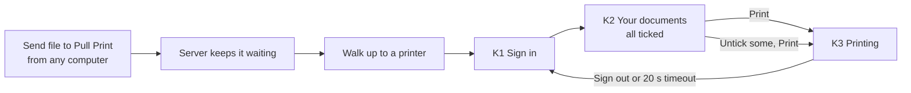
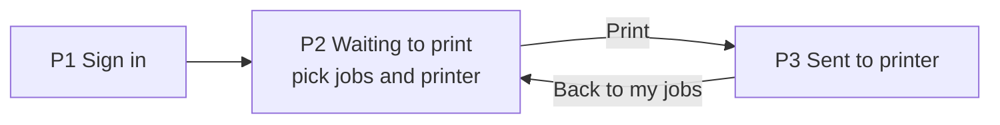
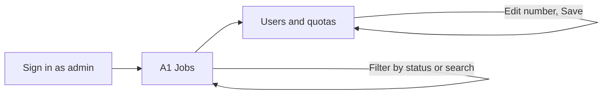

# 02 User flows

Diagrams use Mermaid, which GitHub renders in the page.

## Flow A: print at the printer panel (main flow)

Screens: [K1](03-screen-specs.md#k1-printer-panel--sign-in), [K2](03-screen-specs.md#k2-printer-panel--your-documents), [K3](03-screen-specs.md#k3-printer-panel--printing).

| Step | User does | Screen shows | System does |
|---|---|---|---|
| 1 | Walks up | Sign-in with phone code (card later) | Requests a device code from Microsoft |
| 2 | Enters code on phone, taps confirm | Documents list, all ticked, total pages and pages left | Fetches only this user's waiting jobs |
| 3 | Taps Print | Printing confirmation, pages left | Sends jobs to the printer, reduces quota by pages printed |
| 4 | Leaves | Auto sign-out after 20 seconds | Clears the session on the panel |

## Flow B: print from the phone

This flow lets someone release from their phone without using the panel. See [open decision 3](05-open-decisions.md#3-should-phone-release-require-being-at-the-printer): it weakens the "only when you are at the printer" rule unless the app confirms the person is near it.

## Flow C: administrator

## Error and edge cases

Each needs a designed screen or message before build. Wording is in [03](03-screen-specs.md#states-to-design-next).

| Case | What the person should see | What they can do |
|---|---|---|
| No documents waiting | "Nothing waiting to print" | Sign out |
| Selection is over quota | Print disabled, how many pages over | Untick documents, or ask admin |
| Quota is zero | "You have no pages left this month" | Sign out, contact admin |
| Printer offline or out of paper | Printer name and the problem | Try another printer, which keeps the jobs waiting |
| Sign-in code expired | "That code has expired" and a new code | Get a new code |
| Network lost | "Cannot reach the print server" | Retry |
| Job failed | Job marked as failed with reason | Try again; the job stays waiting |
