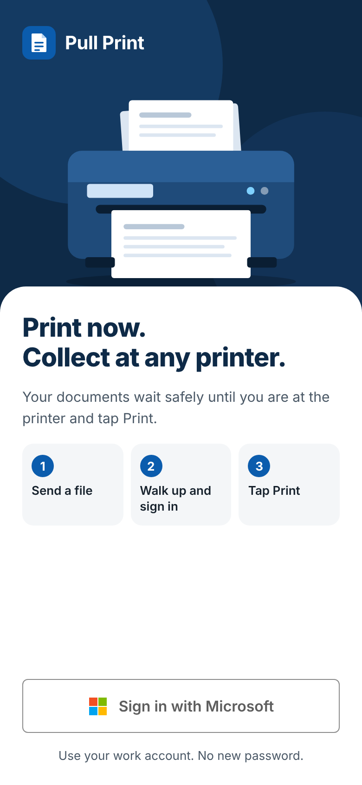
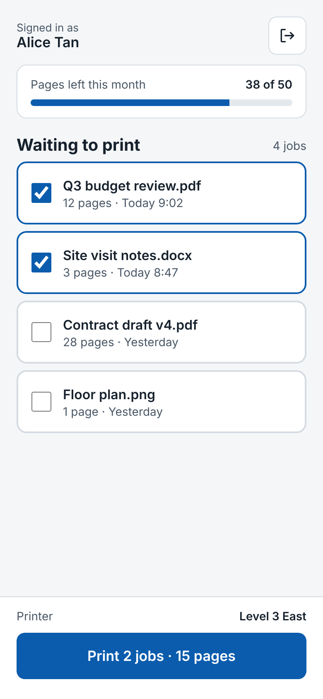
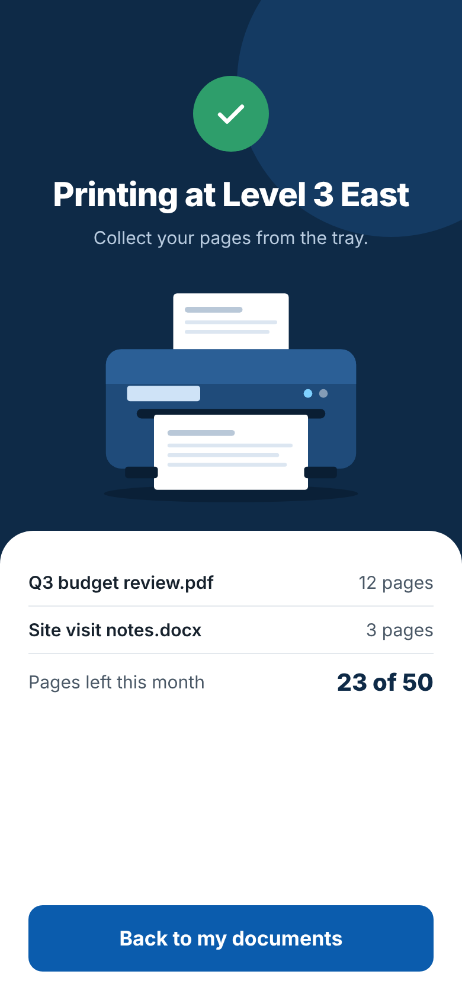
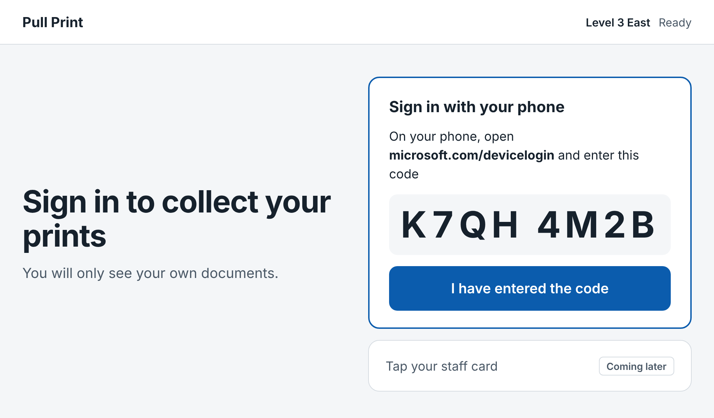
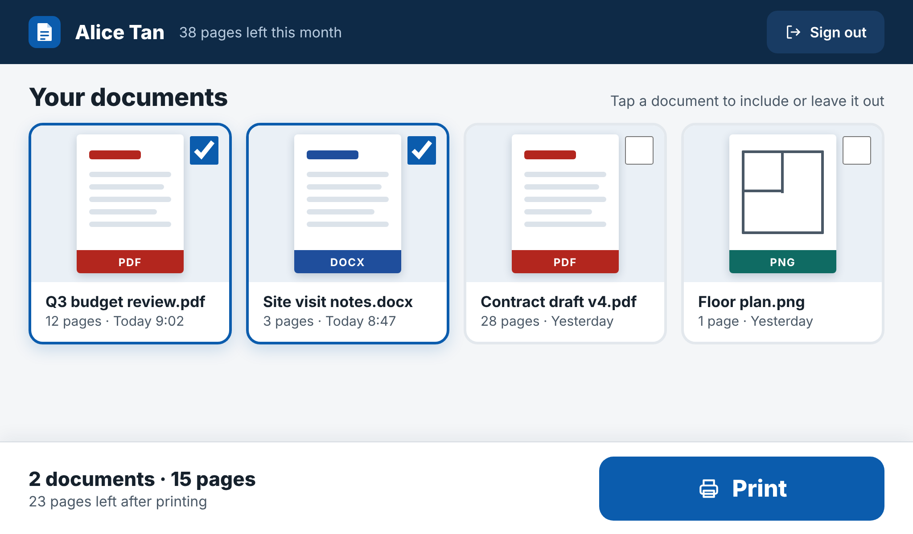
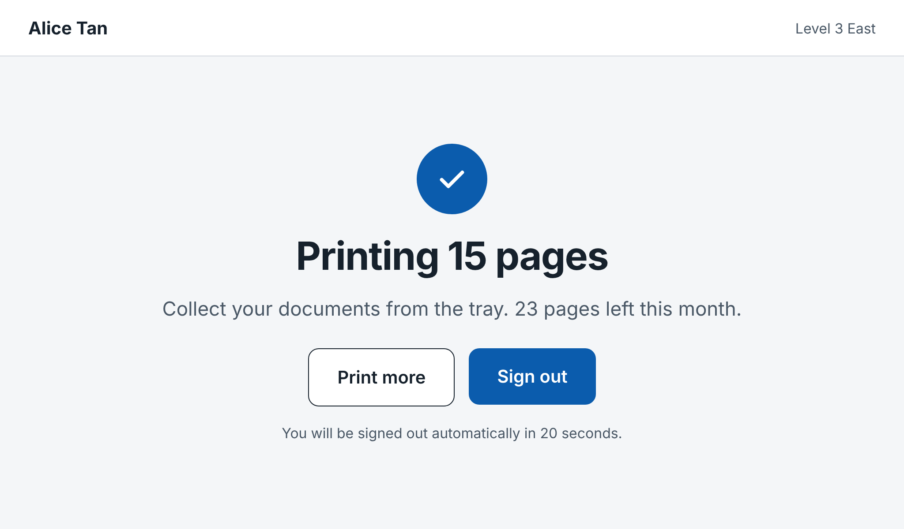
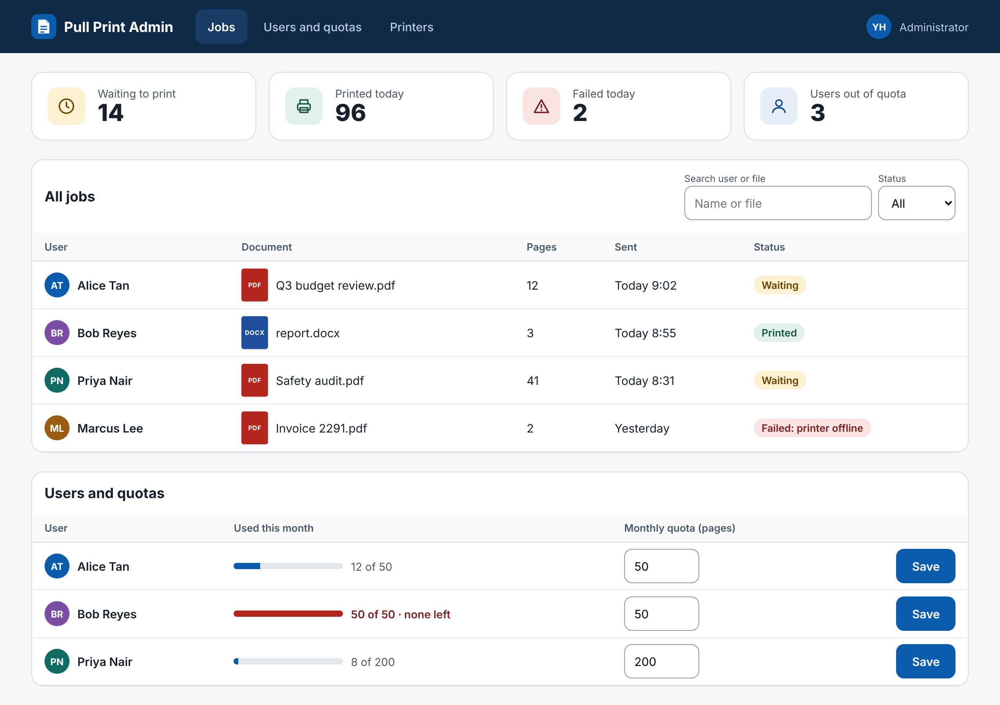

# 03 Screen specs

Seven screens. Images are the mockups in [`design/screens/`](design/screens/).

## Wording

| Avoid | Use |
|---|---|
| Release | Print |
| Held job, spooled | Waiting to print, "Your documents" |
| Quota | Pages left this month |
| Authenticate, credentials | Sign in |
| Error: 403 | A sentence that says what happened and what to do |

---

## P1 Phone: sign in

**Purpose:** get the person signed in, and tell a first-time user what the product does in three lines.

- Dark hero with the printer illustration (a sheet feeds out of it, animated). White sheet below holds the heading and three step cards.
- One button: **Sign in with Microsoft** or **Sign in with Google**, whichever your organisation uses (the server says which), in that company's button style. In the demo it is the Microsoft button and signs in to sample data.
- Under the button, one line says who can sign in, for example "Use your @example.com account. No new password."
- If an account is turned away, a red box above the button says why in plain words and stays until the next try.
- "How it works" is three numbered steps. This is the in-app guide for new users.
- No registration, no password field. Identity comes from the work account.

## P2 Phone: waiting to print

**Purpose:** see own waiting documents and print the ones wanted.

- Pages-left bar at the top.
- Dark header with greeting and a ring showing pages left.
- Each job is a whole row that toggles a checkbox. Shows a document thumbnail with file-type strip, file name, page count, when it was sent. Selecting updates the button and totals live; over quota disables the button and says by how many pages.
- Selected rows have a thick blue border and a tick, so selection is not shown by colour alone.
- Bottom bar: chosen printer and one button that states what it will do, "Print 2 jobs · 15 pages". Tap the printer to pick another when there is more than one. With none set up it says "No printer available" and Print stays off.
- Sign-out is an icon button with an accessible label.

## P3 Phone: sent to printer

**Purpose:** confirm it worked and show pages left.

- Tick, "Sent to Level 3 East", the list of what was sent, and the new pages-left figure.
- One secondary button: **Back to my jobs**.

## K1 Printer panel: sign in

**Purpose:** identify the person at the printer. Screen is 1024 × 600, touch.

- Left: dark panel with logo, heading, reassurance line and the printer illustration.
- Right, primary: sign in with phone. A short code is shown large; the person enters it at `microsoft.com/devicelogin` on their own phone, then taps **I have entered the code**. This is the standard Microsoft device-code sign-in, so no keyboard is needed on the panel.
- Right, secondary: tap staff card, marked "Coming later". This becomes the fast path once readers exist.
- Header shows the printer name and status so people know which printer they are at.

## K2 Printer panel: your documents

**Purpose:** print everything with one tap. The most important screen.

- Header: name, pages left, **Sign out** (always visible).
- Documents are cards with large thumbnails, 4 across; the whole card toggles. Documents sent today are ticked by default.
- Footer: running total ("2 documents · 15 pages"), pages left after printing, and the **Print** button (300 × 72 px, largest element).
- If the selection is over quota, the footer says by how many pages and Print is disabled.

## K3 Printer panel: printing

**Purpose:** confirm and clear the session.

- "Printing 15 pages", "Collect your documents from the tray", pages left.
- **Print more** returns to K2. **Sign out** returns to K1.
- Signs out automatically after 20 seconds, with a visible message saying so.

## A1 Admin: setup, printers, people and jobs

**Purpose:** set the system up once, keep printers and page limits right, find failed jobs.

- **Setup** card first: "Setup is complete", or "Finish setting up" with each thing still to do in plain words, and (for Microsoft or Google) the exact sign-in address to register with a **Copy** button.
- Four counts: waiting, printed today, failed, people out of quota.
- **Printers**: add, rename, switch off and remove. **Copy panel link** gives the address to open on that printer's own screen, which fixes it to that printer.
- **People and quotas**: **New people start with** (a default), **Give everyone** (asks to confirm, because it replaces every limit), then one row per person with an editable number and **Save**. People appear the first time they sign in.
- **All jobs** table with search and status filter. Status is a text label, with a failure reason where there is one.
- Layout is fluid. Tables scroll sideways inside their box on narrow screens.

---

## States and how they are handled

Each is built in the app and covered by a test. Wording is exact.

| Screen | State | What happens |
|---|---|---|
| P2, K2 | Select all | The button above the list ticks every document, then reads **Clear** |
| P2, K2 | One document longer than the pages left | "This document needs 28 pages. You have 8 left." Print is off |
| P2, K2 | More than one document, over quota | "Over your limit by 5 pages. Untick one." |
| P2, K2 | No pages left | "No pages left this month." |
| P3, K3 | Only some documents printed | The ones that printed are listed, and "1 document could not be printed and is still waiting." |
| P2, K2 | Nothing printed | A message, and the person stays on their list |
| P2, K2 | The list was out of date | "Those documents are not waiting to print. Your list has been refreshed." |
| K2 | No touch for 60 seconds | Signed out, with "You were signed out because the screen was idle." |
| any | Session ended (server restart, 8 hours) | Back to sign-in with "Your session has ended. Please sign in again." |
| any | Too many requests | "Too many requests. Please wait a minute and try again." |
| any, demo | Banner | "Demo: nothing is really printed." and **What is this?**, which has **Start over** |

Already built and not repeated above: "Nothing waiting to print." with **Send sample documents** (demo) or "Send a file to Pull Print from your computer.", "Cannot reach the print server." with **Try again**, and "No jobs match." with **Clear filters** on the administrator screen.

Not built yet, described for when they are:

| Screen | State | Message |
|---|---|---|
| K1 | Phone code expired | "That code has expired." Button: "Get a new code" |
| K3 | Printer problem | "The printer is out of paper. Your documents are still waiting." |

## Accessibility checks applied

- Controls are real buttons, links, inputs and labels.
- Text contrast is at least 4.5:1 against its background.
- Touch targets: 44 px minimum on phone and web, 64 px on the panel.
- Selected and status states use a label, shape or border as well as colour.
