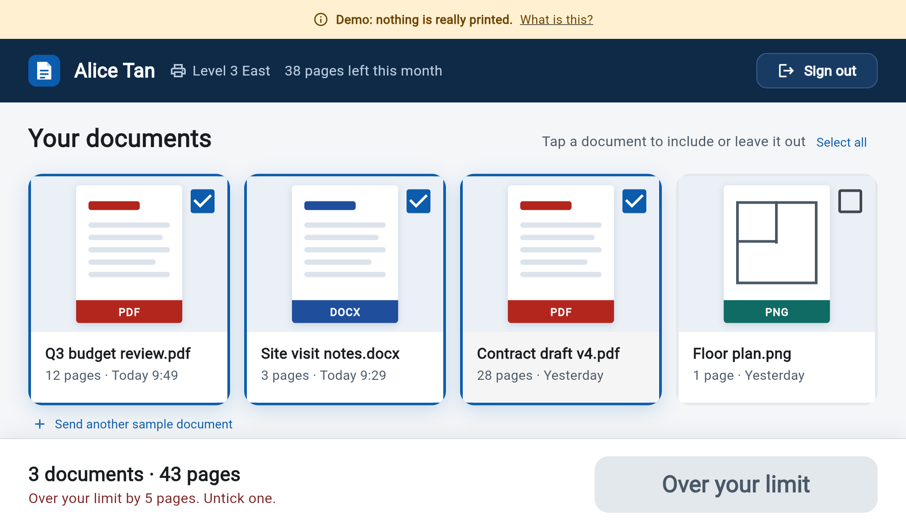

# 10 Getting started

This page walks through Pull Print one screen at a time, for the three kinds of people who use it: someone printing, someone at a printer's own screen, and an administrator. Every picture was taken from the running app.

Click any picture on GitHub to open it full size.

## Before you start

You can try everything with nothing installed: open the [live demo](https://pull-print-demo-hikki-devs-projects.vercel.app). It runs on sample data, so nothing is really printed and no account is needed.

To run your own copy, see the [README](../README.md#run-it-yourself). To use your organisation's accounts, see [Connecting your workspace](09-connecting-your-workspace.md).

## If you are printing

### Sign in

Press the one button. There is no registration and no password: you sign in with your work account. In the demo, the same button opens a private sandbox and the banner at the top says so.

Not sure what the demo is? Press **What is this?** in the banner.

### Choose what to print

* Only **your own** documents are listed, newest first.
* The newest ones are ticked for you, stopping before anything goes over your limit.
* The ring shows how many pages you have left **this month**. It starts again on the 1st.
* Tap a document to tick or untick it. Tick **Select all** to choose everything.

If you tick too much, Print switches off and says what to do:

Untick a document until the button works again. Nothing is charged until a document really prints.

### Pick a printer

If more than one printer is set up, tap the printer name at the bottom.

If you opened a printer's own link, the printer is already chosen and the name is not a button.

### Print

The confirmation names the printer, lists what printed and shows your pages left. If the printer rejected some documents, they are named and stay on your list, and you are not charged for them.

## If you are at a printer's own screen

An administrator opens each printer's **panel link** on the screen next to the printer. It is fixed to that printer, so there is no question about where to print.

Sign in with your work account (the staff-card option is drawn but not built yet).

Tap a document to include or leave it out, then press the large **Print** button. The printer's name and your pages left are at the top.

Over the limit, the button is switched off and says so, the same as on a phone.

The screen signs you out 20 seconds after printing, and after 60 seconds without a touch, so the next person never sees your documents. You can always press **Sign out**.

## If you are an administrator

Sign in with an account on your administrators list. You land on the administrator screen, which has everything in the order you need it.

### 1. Check the setup

The first card says **Setup is complete**, or **Finish setting up** and lists each thing still to do in plain words.

With Microsoft or Google it also shows the exact sign-in address to register, with a **Copy** button.

### 2. Add your printers

Press **Add a printer**, enter a name and where it is.

For each printer you can switch it **On or Off**, edit it, remove it, or press **Copy panel link**. Open the panel link on the screen next to that printer, in full screen. A switched-off printer is hidden from everyone but administrators, and nobody can print there.

### 3. Set page limits

* **New people start with** is the pages a month for anyone who signs in from now on.
* **Give everyone** sets the same number for the whole organisation. It asks first, because it replaces every limit:

  

* Each person has a row. Change the number and press **Save**. The bar shows pages used this month, and turns red when none are left.
* People appear in the list the first time they sign in.

### 4. Watch the jobs

Search by person or file, and filter by status. A failed job says why, for example "printer offline".

## Signing in with a work account

When the server is set up for Microsoft 365 or Google Workspace, the button changes to match and says who can use it.

 

Someone who is not allowed in sees the reason, and can try again:

If the demo is still on, a **Try the demo instead** link is shown too. Turn the demo off for real use (`Demo__Enabled=false`).

## What next

* Something not working? See [Fixing problems](11-fixing-problems.md).
* Connect your own accounts: [Connecting your workspace](09-connecting-your-workspace.md).
* How the pieces fit and every route: [Architecture and API](07-architecture-and-api.md).
